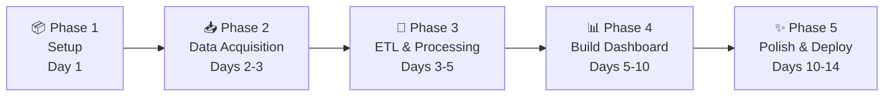

# 🌍 Global Trade of Valuable Metals — Data Visualization Project

## Implementation Plan

> **Stack:** Python + Streamlit | **Purpose:** Portfolio project | **Scope:** Comprehensive interactive dashboard

---

## 📋 Table of Contents

1. [Project Overview](#1-project-overview)
2. [Metals Covered](#2-metals-covered)
3. [Datasets & Sources](#3-datasets--sources)
4. [Project Structure](#4-project-structure)
5. [Step-by-Step Build Guide](#5-step-by-step-build-guide)
6. [Dashboard Pages & Visualizations](#6-dashboard-pages--visualizations)
7. [Tech Stack & Libraries](#7-tech-stack--libraries)
8. [Timeline](#8-timeline)

---

## 1. Project Overview

An interactive **Streamlit multi-page dashboard** that visualizes the global trade patterns of valuable metals — covering trade flows, price trends, top exporters/importers, geospatial maps, and trade network analysis.

### Key Features
- 🗺️ **Geospatial choropleth maps** — export/import volumes by country
- 📈 **Time-series charts** — trade value & price trends (2010–2023)
- 🔗 **Trade network graphs** — bilateral trade relationships
- 📊 **Comparative analysis** — metal-vs-metal, country-vs-country
- 🎛️ **Interactive filters** — by metal, year, country, trade direction

---

## 2. Metals Covered

| Metal | HS Code(s) | Why It Matters |
|-------|-----------|----------------|
| **Gold** | 7108 | Reserve currency, jewelry, electronics |
| **Silver** | 7106 | Solar panels, electronics, jewelry |
| **Platinum** | 7110.11 | Catalytic converters, fuel cells |
| **Palladium** | 7110.21 | Auto catalysts, electronics |
| **Copper** | 7403 | Wiring, EVs, construction |
| **Lithium** | 2825.20 | EV batteries, energy storage |
| **Cobalt** | 8105 | Battery cathodes, superalloys |
| **Rare Earth Elements** | 2846 | Magnets, electronics, defense |

---

## 3. Datasets & Sources

### Primary Dataset — UN Comtrade

| Field | Details |
|-------|---------|
| **URL** | https://comtradeplus.un.org/ |
| **What** | Bilateral trade data (exports & imports) between all countries |
| **Columns** | Reporter, Partner, Year, HS Code, Trade Flow (Import/Export), Trade Value (USD), Net Weight (kg) |
| **Time Range** | 1962–2023 (best coverage: 2010–2023) |
| **Format** | CSV download or REST API |
| **Access** | Free account required; API key for bulk access |
| **How to get** | Register → Get API token → Query by HS codes listed above |

> [!IMPORTANT]
> UN Comtrade is the **backbone** of this project. All trade flow, network, and map visualizations derive from this dataset.

### Secondary Datasets

| Dataset | URL | What You Get | Format |
|---------|-----|-------------|--------|
| **World Bank Commodity Prices (Pink Sheet)** | https://www.worldbank.org/en/research/commodity-markets | Monthly/annual prices for gold, silver, platinum, copper, etc. | Excel/CSV |
| **USGS Mineral Commodity Summaries** | https://www.usgs.gov/centers/national-minerals-information-center/mineral-commodity-summaries | Production, reserves, consumption by country | PDF + data tables |
| **Observatory of Economic Complexity (OEC)** | https://oec.world/ | Pre-processed trade data with nice categorizations | API / CSV |
| **Kaggle — Global Commodity Trade** | https://www.kaggle.com/datasets/unitednations/global-commodity-trade-statistics | UN Comtrade subset, ready to use (~1.2 GB) | CSV |
| **Natural Earth** | https://www.naturalearthdata.com/ | World shapefiles for maps | GeoJSON/SHP |

### Fallback / Quick-Start Option

> [!TIP]
> If the UN Comtrade API is slow or rate-limited, start with the **Kaggle Global Commodity Trade Statistics** dataset. It's a pre-packaged subset of Comtrade data (~2.6M rows) and requires zero API setup.

---

## 4. Project Structure

```
DVP/
├── .streamlit/
│   └── config.toml              # Theme & server config
├── data/
│   ├── raw/                     # Original downloaded CSVs
│   │   ├── comtrade_gold.csv
│   │   ├── comtrade_silver.csv
│   │   ├── commodity_prices.csv
│   │   └── ...
│   ├── processed/               # Cleaned & merged data
│   │   ├── trade_flows.parquet
│   │   ├── price_trends.parquet
│   │   └── country_summary.parquet
│   └── geo/                     # GeoJSON for maps
│       └── world.geojson
├── src/
│   ├── __init__.py
│   ├── data_loader.py           # Data loading + caching
│   ├── data_processor.py        # Cleaning, merging, transformations
│   ├── chart_builder.py         # Reusable Plotly chart functions
│   └── constants.py             # Metal names, HS codes, color palettes
├── pages/
│   ├── 1_🌍_Global_Overview.py
│   ├── 2_📈_Price_Trends.py
│   ├── 3_🗺️_Trade_Maps.py
│   ├── 4_🔗_Trade_Networks.py
│   └── 5_📊_Country_Deep_Dive.py
├── scripts/
│   ├── download_data.py         # Script to fetch data from APIs
│   └── preprocess.py            # ETL pipeline script
├── assets/
│   └── logo.png                 # Project logo/branding
├── app.py                       # Main entry point (Home page)
├── requirements.txt
├── README.md
└── .gitignore
```

---

## 5. Step-by-Step Build Guide

### Phase 1: Environment Setup (Day 1)

```
Step 1.1  Create virtual environment
Step 1.2  Install dependencies (see Tech Stack section)
Step 1.3  Initialize project structure
Step 1.4  Set up .gitignore and git repo
```

### Phase 2: Data Acquisition (Days 2–3)

```
Step 2.1  Register on UN Comtrade → get API key
Step 2.2  Write download_data.py to fetch trade data by HS code
          - Query each metal's HS code
          - Fetch for years 2010–2023
          - Save raw CSVs to data/raw/
Step 2.3  Download World Bank Pink Sheet (commodity prices)
Step 2.4  Download world.geojson from Natural Earth
Step 2.5  (Optional) Download Kaggle dataset as backup
```

### Phase 3: Data Processing & ETL (Days 3–5)

```
Step 3.1  Write data_processor.py:
          - Clean column names, handle missing values
          - Standardize country names (ISO-3 codes)
          - Merge trade data across metals into single DataFrame
          - Compute derived metrics:
            • Trade balance per country per metal
            • Year-over-year growth rates
            • Market share percentages
          - Save to Parquet format for fast loading
Step 3.2  Write data_loader.py:
          - @st.cache_data decorated functions
          - Load from processed/ Parquet files
          - Provide filtered views by metal, year, country
Step 3.3  Create constants.py:
          - Metal → HS code mapping
          - Color palette per metal
          - Country ISO-3 → display name mapping
```

### Phase 4: Build Core Visualizations (Days 5–10)

```
Step 4.1  chart_builder.py — reusable Plotly functions:
          - choropleth_map(df, metric, title)
          - time_series_line(df, metals, metric)
          - top_n_bar_chart(df, n, metric)
          - trade_flow_sankey(df, metal, year)
          - network_graph(df, metal, year)
          - treemap(df, metal, year)

Step 4.2  Build each dashboard page (details in Section 6)
```

### Phase 5: Polish & Deploy (Days 10–14)

```
Step 5.1  Add Streamlit theming (.streamlit/config.toml)
Step 5.2  Add sidebar branding, logo, about section
Step 5.3  Add KPI metric cards on each page
Step 5.4  Performance optimization (caching, lazy loading)
Step 5.5  Write README.md with screenshots
Step 5.6  Deploy to Streamlit Community Cloud
Step 5.7  (Optional) Add GitHub Pages landing page
```

---

## 6. Dashboard Pages & Visualizations

### 🏠 Home Page (`app.py`)

| Element | Type |
|---------|------|
| Project title + description | Markdown |
| Key stats cards | `st.metric` — Total global trade value, # of countries, # of metals |
| Quick overview bar chart | Top 10 traded metals by value |
| Navigation guide | Links to sub-pages |

---

### Page 1: 🌍 Global Overview

| Visualization | Library | Description |
|--------------|---------|-------------|
| **Stacked area chart** | Plotly | Total trade value of all metals over time |
| **Grouped bar chart** | Plotly | Export vs Import by metal (selected year) |
| **Treemap** | Plotly | Hierarchical view: Metal → Top countries |
| **KPI cards** | Streamlit | YoY growth, dominant metal, top exporter |

**Filters:** Year range slider, metal multi-select

---

### Page 2: 📈 Price Trends

| Visualization | Library | Description |
|--------------|---------|-------------|
| **Multi-line chart** | Plotly | Price trends for selected metals (normalized or absolute) |
| **Candlestick chart** | Plotly | Monthly price volatility for a selected metal |
| **Correlation heatmap** | Plotly | Price correlation matrix between metals |
| **Price vs Trade Volume scatter** | Plotly | Does higher price = more trade? |

**Filters:** Metal selector, date range, normalization toggle

---

### Page 3: 🗺️ Trade Maps

| Visualization | Library | Description |
|--------------|---------|-------------|
| **Choropleth map (exports)** | Plotly | Countries colored by export value |
| **Choropleth map (imports)** | Plotly | Countries colored by import value |
| **Trade balance map** | Plotly | Net exporter (green) vs net importer (red) |
| **Animated map** | Plotly | Year-by-year animation of trade patterns |

**Filters:** Metal selector, year slider/animation, trade direction toggle

---

### Page 4: 🔗 Trade Networks

| Visualization | Library | Description |
|--------------|---------|-------------|
| **Sankey diagram** | Plotly | Top N trade flows: source → destination |
| **Network graph** | PyVis/NetworkX | Interactive node-link diagram of bilateral trade |
| **Chord diagram** | Plotly | Circular flow between top trading nations |
| **Top trade routes table** | Streamlit | Sortable table of biggest bilateral trades |

**Filters:** Metal, year, top-N slider, minimum trade value threshold

---

### Page 5: 📊 Country Deep Dive

| Visualization | Library | Description |
|--------------|---------|-------------|
| **Country profile card** | Streamlit | Flag, key stats, trade balance |
| **Export/Import composition pie** | Plotly | Which metals does this country trade? |
| **Trading partners bar** | Plotly | Top 10 partners for selected metal |
| **Time series** | Plotly | Country's trade trend over years |
| **Comparison mode** | Plotly | Side-by-side compare two countries |

**Filters:** Country selector (with search), metal, year range

---

## 7. Tech Stack & Libraries

### `requirements.txt`

```
streamlit>=1.30.0
pandas>=2.1.0
numpy>=1.25.0
plotly>=5.18.0
pydeck>=0.8.0
networkx>=3.2
pyvis>=0.3.2
pycountry>=22.3.5
requests>=2.31.0
openpyxl>=3.1.0
pyarrow>=14.0.0
streamlit-option-menu>=0.3.6
streamlit-extras>=0.3.5
```

### Key Library Roles

| Library | Purpose |
|---------|---------|
| `streamlit` | Dashboard framework |
| `pandas` + `pyarrow` | Data manipulation + fast Parquet I/O |
| `plotly` | All interactive charts, maps, Sankey diagrams |
| `networkx` + `pyvis` | Trade network graph construction & visualization |
| `pycountry` | ISO country code standardization |
| `pydeck` | Optional 3D globe visualizations |
| `requests` | API calls to UN Comtrade |

---

## 8. Timeline



| Phase | Days | Deliverable |
|-------|------|-------------|
| Setup | 1 | Environment, structure, git repo |
| Data | 2–3 | Raw CSVs downloaded, API scripts working |
| ETL | 3–5 | Clean Parquet files, data_loader ready |
| Build | 5–10 | All 5 dashboard pages functional |
| Polish | 10–14 | Themed, branded, deployed to Streamlit Cloud |

---

## 🚀 Next Steps

Once you approve this plan, I will:

1. **Scaffold the entire project structure** (all folders + boilerplate files)
2. **Write the data download scripts** for UN Comtrade API & World Bank
3. **Build the data processing pipeline**
4. **Implement each dashboard page** one by one
5. **Add theming and polish**

> [!NOTE]
> We can build this **incrementally** — get a working dashboard with one metal first, then expand to all eight.
